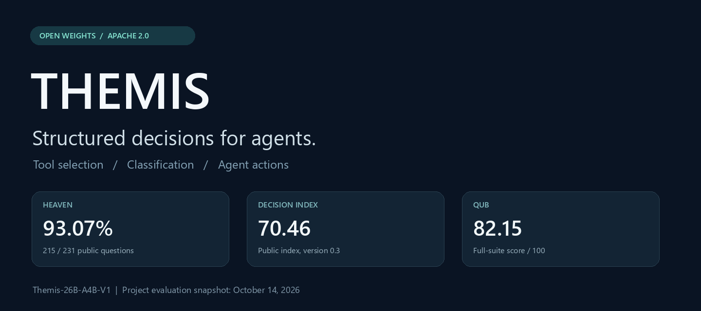
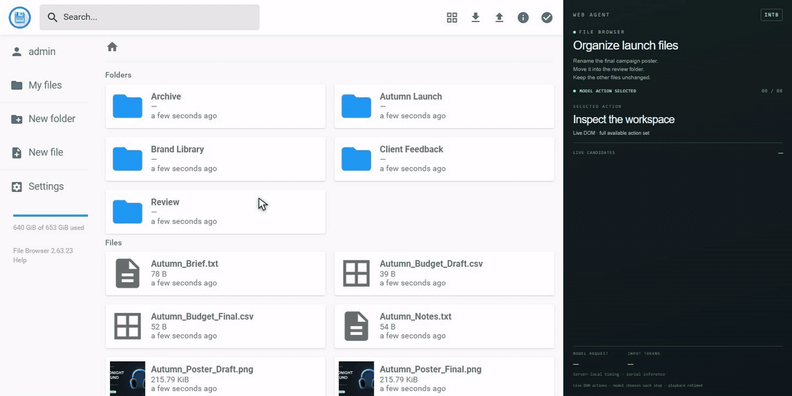
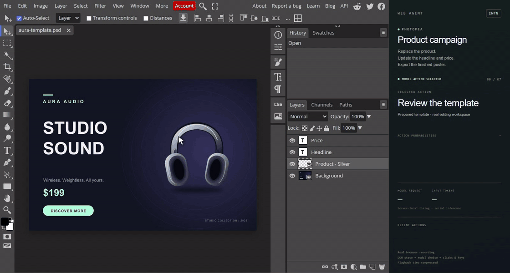
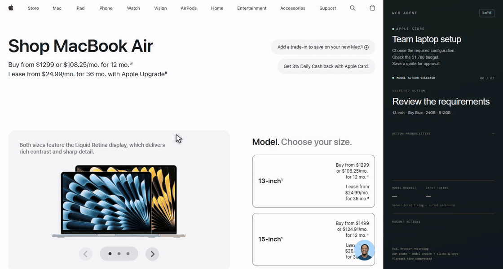
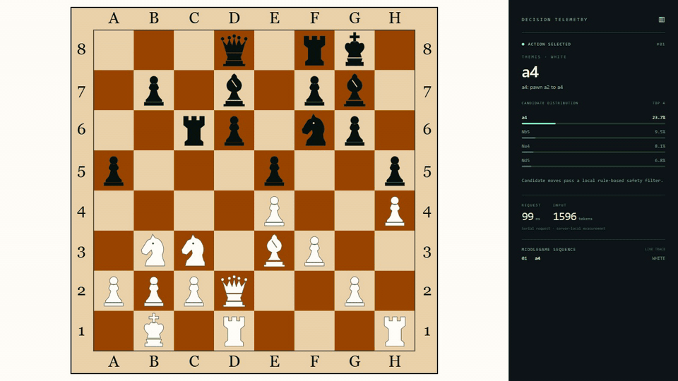
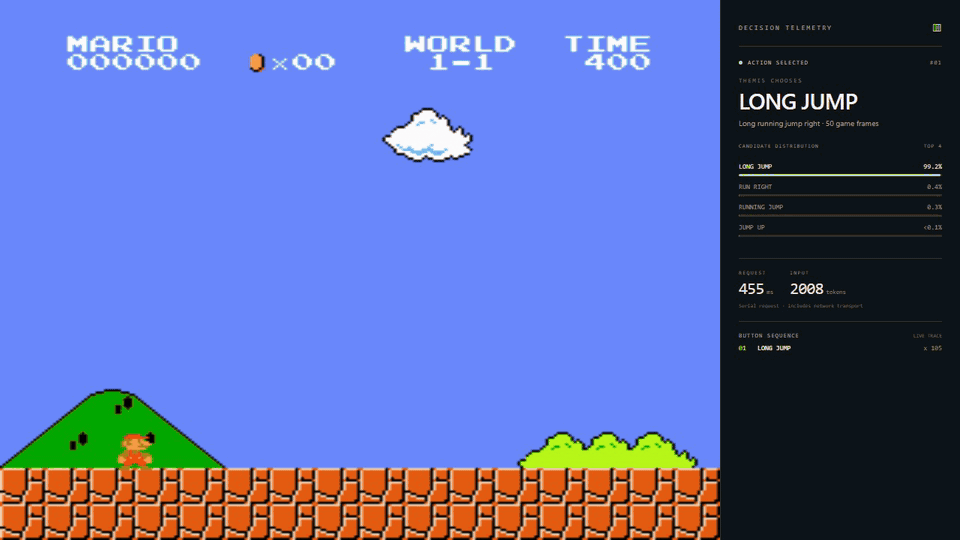
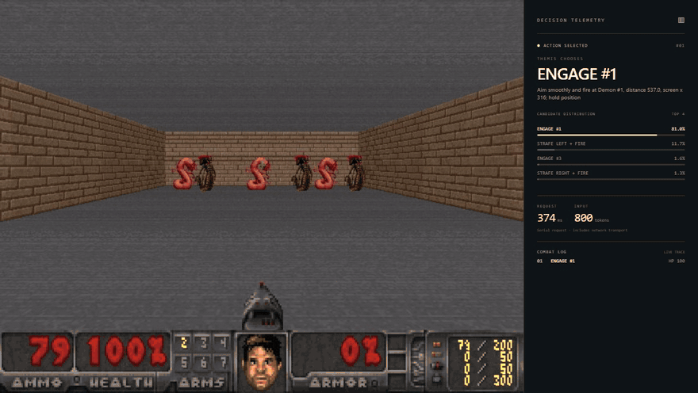
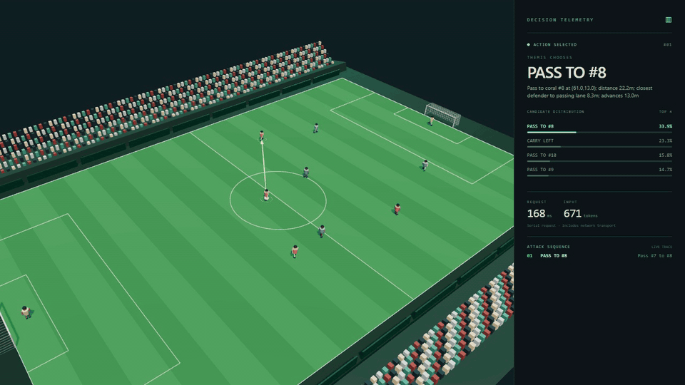

# Themis

**An open-weight structured decision model for tool selection, classification, and agent actions.**

**English** | [简体中文](README.zh-CN.md)

[Model weights](https://huggingface.co/lili55339/Themis-26B-A4B-V1) · [Evaluation details](docs/benchmarks.md) · [Download guide](docs/download.md) · [Apache 2.0](LICENSE)



Themis takes a situation and a set of questions or candidate actions, then returns structured decisions and probabilities. Applications include choosing a tool, classifying a request, evaluating business rules, and selecting an agent's next action.

The current model release is **Themis-26B-A4B-V1**, based on **Google DeepMind's Gemma 4 26B-A4B-it**, with INT8 model weights available on Hugging Face.

## Evaluation snapshot

Results below are from the project's completed evaluation runs, recorded on **October 14, 2026**. Each benchmark uses its own measurement convention.

| Evaluation | Result | Scope |
| --- | ---: | --- |
| Heaven | **93.07%** | 215 / 231 correct on the same public question set |
| Decision Index 0.3 | **70.46** | Public, baseline-corrected index; 37 question sets across five domains |
| QUB / jevbench-240 | **82.15 / 100** | Full-suite consistency score over 240 cases |
| Heaven serial latency | **43.54 ms P50 · 131.78 ms P95** | 231 single-question requests on one RTX PRO 6000 Blackwell Server Edition |

Latency measures same-machine HTTP request submission through receipt of the complete response. Model loading and service warmup are excluded; the first measured request is included. These Heaven inputs range from 91 to 3,869 tokens. Hardware, input length and serving conditions affect latency.

The [full evaluation notes](docs/benchmarks.md) include comparison tables, longer-input measurements, and workflow results where Themis trails the listed Jev baseline. The QUB result is a project-run evaluation and has not been registered as an official leaderboard submission.

## See it in action

### File organization

Find a specified poster, rename and archive it, then verify the destination folder.



### Product poster editing

Replace a product image, adjust the layout, update the headline and price, and export the poster in Photopea.



### Computer configuration

Select specifications, check a budget and quoted price, and save the configuration for review.



### Chess: middlegame play



Play from a complex middlegame, progressing through exchanges, attacks, and defense.

### Super Mario Bros.: running and jumping



Run, jump, cross obstacles, and advance through a classic Mario level.

### DOOM: frontal defense



Aim at incoming enemies and keep firing while responding to successive attacks.

### Five-a-side football: an attacking move



Complete an attacking sequence with passing, dribbling, and shooting, and score a goal.

These seven recordings show the project evaluation setup. The [Hugging Face model card](https://huggingface.co/lili55339/Themis-26B-A4B-V1#4-application-demos) also includes the complete demonstrations; this repository provides documentation and download utilities.

## Download the model

Use Python 3.10 or later. Preview the download first, then fetch the pinned model release:

```bash
pip install -r requirements.txt
python examples/download_model.py --dry-run
python examples/download_model.py --local-dir ./models/Themis-26B-A4B-V1
```

The default revision is `d72b3f8d2ed16f20e9270c29d012e820b93fb31a`. The 31 weight shards occupy about **27.69 GB** in decimal units; allow additional space for the tokenizer and download metadata. The helper uses an explicit file list and supports resuming downloads through `huggingface_hub`.

See [download options](docs/download.md) for a small metadata-only download and CLI instructions.

### Inference availability

Running these weights requires a compatible Themis inference runtime supplied separately. This repository includes a download utility; an inference server and hosted API are currently outside this release. Direct loading with `AutoModelForCausalLM.from_pretrained()` has not been validated for this package.

## Repository contents

- **GitHub:** bilingual documentation, evaluation summaries, selected demo recordings, and a model-download utility.
- **Hugging Face:** model weights, required configuration and tokenizer files.
- **Publication scope:** training pipelines, training datasets and internal architecture implementations are maintained separately and are outside this publication.

## Feedback and contributions

Use [Issues](https://github.com/foryourhealth111-pixel/Themis/issues) for download problems, documentation corrections, and use-case feedback. Include the model revision and relevant environment details. Share reproducible examples that you have permission to publish. See [CONTRIBUTING.md](CONTRIBUTING.md).

## License and attribution

The original documentation, download utility and publication checks in this repository are provided under the **Apache License, Version 2.0**. The linked Themis model artifacts are also distributed under Apache 2.0. See [LICENSE](LICENSE) and [NOTICE](NOTICE).

Third-party content depicted in demonstration media remains subject to the rights of its respective owners. The model and project licenses grant no additional rights to that content or to third-party trademarks.
