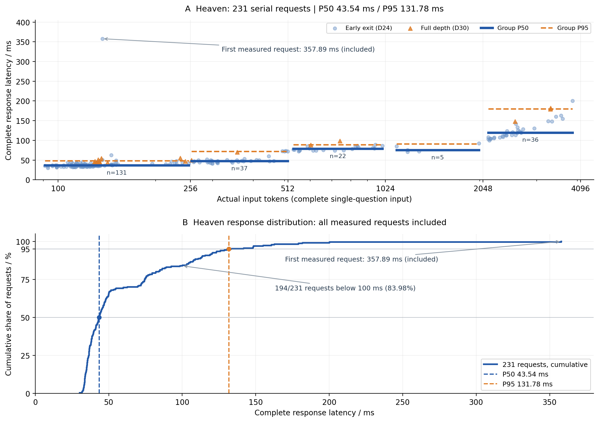

# Evaluation notes

[Project overview](../README.md) | [简体中文](benchmarks.zh-CN.md)

Snapshot: October 14, 2026. These results are reported by the Themis project from completed runs and saved public baseline snapshots.

## 2. Public evaluation results

| Evaluation | Themis INT8 | Coverage and measurement |
| --- | ---: | --- |
| **Heaven** | **93.07%** | 215 correct answers on the same set of 231 public questions; all requests valid. |
| **Decision Index 0.3** | **70.46** | Public, baseline-corrected index; raw index 77.53; 37 question sets across 5 domains, with 140,178 valid requests. |
| **QUB / jevbench-240** | **82.15 / 100** | Full-suite consistency score; 240 cases, 50 relational checks, and 14,838 outcomes. |

Heaven measures correctness on public tasks. Decision Index uses random-baseline correction and domain weighting. QUB measures consistency across probabilities and related decisions. The comparisons below retain each benchmark's native measurement conventions.

### 2.1 Heaven: the same 231 public questions

| Model / mode | Correct | Accuracy |
| --- | ---: | ---: |
| **Themis 26B-A4B V1 INT8** | **215 / 231** | **93.07%** |
| OpenJev (thinking, BF16) | 205 / 231 | 88.74% |
| djev (thinking) | 202 / 231 | 87.45% |
| reflex-27b (Qwen3.8-27B) | 201 / 231 | 87.01% |
| Jev 1.13.0 (TypeSafe AI) | 200 / 231 | 86.58% |
| openjev-sglang (Qwen3.6-35B-A3B, SGLang) | 197 / 231 | 85.28% |

On this comparison using identical questions, Themis INT8 answers **15 more questions** correctly than Jev 1.13.0, an advantage of **6.49 percentage points**. It exceeds OpenJev thinking by **4.33 percentage points**. The comparison uses the saved 231-question public snapshot and retains each model's execution mode.

Themis INT8's Heaven macro accuracy is **92.00%**, ECE is **0.02816**, mean Brier score is **0.10814**, and paraphrase consistency is **35 / 36 (97.22%)**.

### 2.2 Decision Index 0.3: public index

| Model | Public index | Themis INT8 minus baseline |
| --- | ---: | ---: |
| **Themis 26B-A4B V1 INT8** | **70.46** | — |
| Torchcast Decision 27B | 65.10 | +5.36 |
| Perplexity Decider v1.1 (27B) | 62.25 | +8.21 |
| Cloudflare clef | 61.71 | +8.75 |
| Quyet-1.0-Large | 60.79 | +9.67 |
| Fastino GLiDE no-thinking (28B) | 59.06 | +11.40 |
| Jev | 57.96 | +12.50 |
| Kev 27B | 56.69 | +13.77 |
| JPT-9B | 46.96 | +23.50 |

Themis INT8's public index exceeds Jev by **12.50 points** and Torchcast Decision 27B by **5.36 points**. This table covers the public portion of Decision Index 0.3. The leaderboard's Full score also includes private evaluations held by its maintainers.

| Domain | Themis INT8 | Jev | Difference |
| --- | ---: | ---: | ---: |
| Knowledge and reasoning | 64.04 | 53.87 | +10.17 |
| Language understanding | 69.38 | 59.23 | +10.15 |
| Retrieval and classification | 70.71 | 55.42 | +15.29 |
| Tools and automation | **85.86** | 75.09 | +10.77 |
| Arts and human preferences | 61.18 | 39.08 | +22.10 |

Coverage is 100% in all five domains. Jev's domain scores were recalculated from the corresponding public component scores using the native weights. Themis INT8 scores higher in all five domains in this comparison.

### 2.3 QUB: the full jevbench-240 suite

| Model | Full-suite score / 100 | Themis INT8 minus baseline |
| --- | ---: | ---: |
| Open-Jev-9B | 83.90 | -1.75 |
| **Themis 26B-A4B V1 INT8** | **82.15** | — |
| JevAny-Gemma-4B (pointer) | 79.03 | +3.12 |
| JevAny-Qwen-4B (direct token) | 78.60 | +3.55 |
| JevAny-Qwen-4B (pointer) | 78.27 | +3.88 |
| decider-4b v2.1 | 77.27 | +4.88 |
| TinyJev-4B | 75.18 | +6.97 |
| OneJev-4B | 72.91 | +9.24 |

The comparison uses saved full-suite results. Open-Jev-9B scores **1.75 points** above Themis INT8; Themis INT8 scores above the remaining models in the table. This result has not been registered as an official leaderboard submission. A corresponding TypeSafe Jev 1.13.0 result is unavailable under this measurement convention.

| QUB dimension | Meaning | Themis INT8 / 100 |
| --- | --- | ---: |
| REP | Consistency under changes in representation | 87.61 |
| BAT | Batching and question isolation | 97.33 |
| MEA | Probability-measure consistency | 58.97 |
| LOG | Consistency with logical constraints | 94.63 |
| CHO | Choice consistency | 72.22 |

The QUB overall score has a **95% bootstrap interval of 81.22–83.04**. The complete run made 10,320 actual calls and returned an empty error list.

### 2.4 Supplementary workflow evaluations

The following results use WorkflowEvals consensus labels and each workflow's native metrics.

| Workflow / metric | Themis INT8 | Jev | Difference |
| --- | ---: | ---: | ---: |
| Invoice processing / exact_actions | 58.67% | 61.78% | -3.11 percentage points |
| Invoice processing / primary_action | 82.00% | 83.11% | -1.11 percentage points |
| Customer service / exact_actions | 73.53% | 75.98% | -2.45 percentage points |
| Security incidents / exact_actions | 55.83% | 61.67% | -5.83 percentage points |
| Agent trajectory observation / primary_action | 63.06% | 71.62% | -8.56 percentage points |

All 705 cases across the four workflows completed execution. Action-matching quality is reported in the table. Jev baselines come from the corresponding public records; Themis INT8 scores lower on these workflow metrics.

## 3. Serial request latency

### 3.1 Overall Heaven latency

The main latency results come from **231 serial Heaven requests**. Each request contains one question, and the next request starts after the complete response arrives. The hardware is one **NVIDIA RTX PRO 6000 Blackwell Server Edition**, running the INT8 model.

Timing spans submission of an HTTP request by a client on the same machine through receipt of the complete structured response. It includes input processing, inference, and response delivery. Model loading and service warmup finish before timing starts; the first measured request is included. Remote deployment adds the corresponding network round-trip time.

| Metric | Measured on Heaven |
| --- | ---: |
| **P50 / median** | **43.54 ms** |
| **P95** | **131.78 ms** |
| Mean | 60.47 ms |
| P99 | 180.96 ms |
| Successful requests | 231 / 231 |

**65.37%** of requests finish below 50 ms, **83.98%** below 100 ms, and **91.77%** below 120 ms.

### 3.2 Heaven: latency by input length

Actual input lengths range from **91 to 3,869 tokens**. Length comes from `usage.input_tokens` in the response and includes the state, question, candidate descriptions, and prompt wrapping.

| Input tokens | Requests | P50 / ms | P95 / ms | Mean / ms |
| --- | ---: | ---: | ---: | ---: |
| ≤256 | 131 | 36.77 | 48.48 | 40.69 |
| 257–512 | 37 | 47.78 | 72.41 | 50.65 |
| 513–1,024 | 22 | 78.75 | 89.21 | 80.29 |
| 1,025–2,048 | 5 | 75.55 | 90.84 | 79.11 |
| 2,049–4,096 | 36 | 119.91 | 179.72 | 127.82 |

In this dataset, a typical request takes about **37 ms** for short inputs and about **120 ms** for 2K–4K-token inputs. Question composition and sample sizes differ between groups; the 1K–2K group contains only five samples.

### 3.3 Supplementary measurement: 4,097–8,192 tokens

This Heaven run reaches 3,869 input tokens. Longer inputs were measured separately using public questions from **Decision Index 0.3**: 50 actual single-question samples, each measured three times, for 150 serial requests. Actual input lengths range from **4,131 to 8,032 tokens**. Four warmup requests precede measurement, and every subsequent measured request is included.

| Input tokens | Distinct questions / requests | P50 / ms | P95 / ms | Mean / ms |
| --- | ---: | ---: | ---: | ---: |
| 4,097–5,120 | 15 / 45 | 185.72 | 219.00 | 192.60 |
| 5,121–6,144 | 15 / 45 | 244.48 | 269.37 | 232.59 |
| 6,145–7,168 | 15 / 45 | 255.57 | 297.31 | 264.71 |
| 7,169–8,192 | 5 / 15 | 294.27 | 383.94 | 324.70 |
| **Overall** | **50 / 150** | **244.45** | **337.50** | **239.44** |

All 150 measured requests succeeded. The highest-length group contains five distinct questions and 15 timings, so its P95 is sensitive to question composition. The longest input actually measured is 8,032 tokens.

