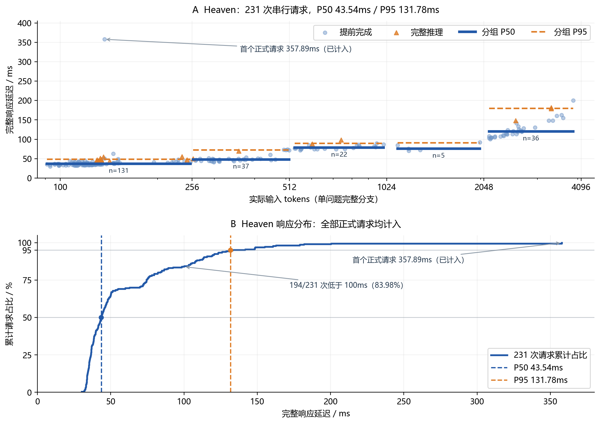

# 评测说明

[项目首页](../README.zh-CN.md) | [English](benchmarks.md)

记录日期：2026 年 10 月 14 日。以下结果由 Themis 项目根据已完成的评测和保存的公开基线快照整理。

## 2. 公开评测结果

| 评测 | Themis INT8 | 覆盖与口径 |
| --- | ---: | --- |
| **Heaven** | **93.07%** | 同一组 231 道公开题，答对 215 道，全部请求有效。 |
| **Decision Index 0.3** | **70.46** | 公开校正指数；原始指数 77.53；37 个题集、5 个领域，140,178 次有效请求。 |
| **QUB / jevbench-240** | **82.15 / 100** | 完整套件一致性分数；240 个案例、50 个关系检查、14,838 个 outcomes。 |

Heaven 衡量公开任务上的正确性，Decision Index 使用随机基线校正和领域加权，QUB 衡量概率与相关决策的一致性。以下按各自原生口径比较。

### 2.1 Heaven：同一组 231 道公开题

| 模型 / 模式 | 正确数 | 准确率 |
| --- | ---: | ---: |
| **Themis 26B-A4B V1 INT8** | **215 / 231** | **93.07%** |
| OpenJev（thinking，BF16） | 205 / 231 | 88.74% |
| djev（thinking） | 202 / 231 | 87.45% |
| reflex-27b（Qwen3.8-27B） | 201 / 231 | 87.01% |
| Jev 1.13.0（TypeSafe AI） | 200 / 231 | 86.58% |
| openjev-sglang（Qwen3.6-35B-A3B，SGLang） | 197 / 231 | 85.28% |

在这组同题对照中，Themis INT8 比 Jev 1.13.0 多答对 **15 道题**，准确率高 **6.49 个百分点**；比 OpenJev thinking 高 **4.33 个百分点**。这里采用已保存的 231 题公开快照，保留各模型的运行模式。

Themis INT8 的 Heaven macro accuracy 为 **92.00%**，ECE 为 **0.02816**，Brier mean 为 **0.10814**，改写一致性为 **35 / 36（97.22%）**。

### 2.2 Decision Index 0.3：公开指数

| 模型 | 公开指数 | Themis INT8 − 对照 |
| --- | ---: | ---: |
| **Themis 26B-A4B V1 INT8** | **70.46** | — |
| Torchcast Decision 27B | 65.10 | +5.36 |
| Perplexity Decider v1.1（27B） | 62.25 | +8.21 |
| Cloudflare clef | 61.71 | +8.75 |
| Quyet-1.0-Large | 60.79 | +9.67 |
| Fastino GLiDE no-thinking（28B） | 59.06 | +11.40 |
| Jev | 57.96 | +12.50 |
| Kev 27B | 56.69 | +13.77 |
| JPT-9B | 46.96 | +23.50 |

Themis INT8 的公开指数比 Jev 高 **12.50 分**，比 Torchcast Decision 27B 高 **5.36 分**。本表使用 Decision Index 0.3 的公开部分；榜单 Full score 还包含维护者私有评测。

| 领域 | Themis INT8 | Jev | 差值 |
| --- | ---: | ---: | ---: |
| 知识与推理 | 64.04 | 53.87 | +10.17 |
| 语言理解 | 69.38 | 59.23 | +10.15 |
| 检索与分类 | 70.71 | 55.42 | +15.29 |
| 工具与自动化 | **85.86** | 75.09 | +10.77 |
| 艺术与人类偏好 | 61.18 | 39.08 | +22.10 |

五个领域覆盖率均为 100%。Jev 领域分数按对应公开分项及原生权重重算；Themis INT8 在这组对照的五个领域中均取得更高分数。

### 2.3 QUB：完整 jevbench-240

| 模型 | 完整套件分数 / 100 | Themis INT8 − 对照 |
| --- | ---: | ---: |
| Open-Jev-9B | 83.90 | -1.75 |
| **Themis 26B-A4B V1 INT8** | **82.15** | — |
| JevAny-Gemma-4B（pointer） | 79.03 | +3.12 |
| JevAny-Qwen-4B（direct token） | 78.60 | +3.55 |
| JevAny-Qwen-4B（pointer） | 78.27 | +3.88 |
| decider-4b v2.1 | 77.27 | +4.88 |
| TinyJev-4B | 75.18 | +6.97 |
| OneJev-4B | 72.91 | +9.24 |

对照采用已保存的完整套件成绩。Open-Jev-9B 比 Themis INT8 高 **1.75 分**；Themis INT8 高于表中的其余模型。本结果尚未作为官方榜单提交登记，TypeSafe Jev 1.13.0 在这一口径下缺少对应成绩。

| QUB 维度 | 含义 | Themis INT8 / 100 |
| --- | --- | ---: |
| REP | 表示变化下的一致性 | 87.61 |
| BAT | 批处理与问题隔离 | 97.33 |
| MEA | 概率测度一致性 | 58.97 |
| LOG | 逻辑约束一致性 | 94.63 |
| CHO | 选择一致性 | 72.22 |

QUB overall 的 95% bootstrap 区间为 **81.22–83.04**。完整运行完成 10,320 次真实调用，错误列表为空。

### 2.4 补充工作流评测

以下使用 WorkflowEvals 的 consensus 标签及各工作流原生指标。

| 工作流 / 指标 | Themis INT8 | Jev | 差值 |
| --- | ---: | ---: | ---: |
| 发票处理 / exact_actions | 58.67% | 61.78% | -3.11 个百分点 |
| 发票处理 / primary_action | 82.00% | 83.11% | -1.11 个百分点 |
| 客户服务 / exact_actions | 73.53% | 75.98% | -2.45 个百分点 |
| 安全事件 / exact_actions | 55.83% | 61.67% | -5.83 个百分点 |
| Agent 轨迹观测 / primary_action | 63.06% | 71.62% | -8.56 个百分点 |

四个工作流共 705 个案例完成执行，动作匹配质量按上表报告。Jev 对照来自相应公开记录；这些工作流中的 Themis INT8 指标低于该基线。

## 3. 串行请求延迟

### 3.1 Heaven 整体延迟

主要延迟结果来自 Heaven 的 **231 次串行请求**：每次提交一道问题，收到完整响应后再提交下一次。硬件为单张 **NVIDIA RTX PRO 6000 Blackwell Server Edition**，模型为 INT8 版本。

计时覆盖同机客户端提交 HTTP 请求到完整结构化响应返回，包含输入处理、推理与响应返回。模型加载及服务预热在计时前完成，首个正式请求保留在统计中。远程部署还会增加相应的网络往返时间。

| 指标 | Heaven 实测 |
| --- | ---: |
| **P50 / 中位数** | **43.54 ms** |
| **P95** | **131.78 ms** |
| 平均耗时 | 60.47 ms |
| P99 | 180.96 ms |
| 成功请求 | 231 / 231 |

其中，**65.37%** 的请求低于 50 ms，**83.98%** 低于 100 ms，**91.77%** 低于 120 ms。

### 3.2 Heaven：不同输入长度

实际输入范围为 **91–3,869 tokens**。长度取响应中的 `usage.input_tokens`，包含状态、问题、候选描述及提示包装。

| 输入 tokens | 请求数 | P50 / ms | P95 / ms | 平均 / ms |
| --- | ---: | ---: | ---: | ---: |
| ≤256 | 131 | 36.77 | 48.48 | 40.69 |
| 257–512 | 37 | 47.78 | 72.41 | 50.65 |
| 513–1,024 | 22 | 78.75 | 89.21 | 80.29 |
| 1,025–2,048 | 5 | 75.55 | 90.84 | 79.11 |
| 2,049–4,096 | 36 | 119.91 | 179.72 | 127.82 |

这组数据中，典型单次耗时从短输入的约 **37 ms**，增加到 2K–4K 输入的约 **120 ms**。不同长度组的题目组成与样本数存在差异，其中 1K–2K 组只有 5 个样本。

### 3.3 补充实测：4,097–8,192 tokens

Heaven 本轮样本覆盖到 3,869 tokens。更长输入采用 **Decision Index 0.3 公开题**单独测试：选取 50 道真实单问题样本，每题测量 3 次，共 150 次串行请求；实际输入为 **4,131–8,032 tokens**。测量前执行 4 次预热，随后全部正式请求纳入统计。

| 输入 tokens | 独立题数 / 请求数 | P50 / ms | P95 / ms | 平均 / ms |
| --- | ---: | ---: | ---: | ---: |
| 4,097–5,120 | 15 / 45 | 185.72 | 219.00 | 192.60 |
| 5,121–6,144 | 15 / 45 | 244.48 | 269.37 | 232.59 |
| 6,145–7,168 | 15 / 45 | 255.57 | 297.31 | 264.71 |
| 7,169–8,192 | 5 / 15 | 294.27 | 383.94 | 324.70 |
| **总体** | **50 / 150** | **244.45** | **337.50** | **239.44** |

150 次正式请求全部成功。最高长度档包含 5 道独立题、15 次计时，P95 会受到题目组成影响；本次实测最长输入为 8,032 tokens。

