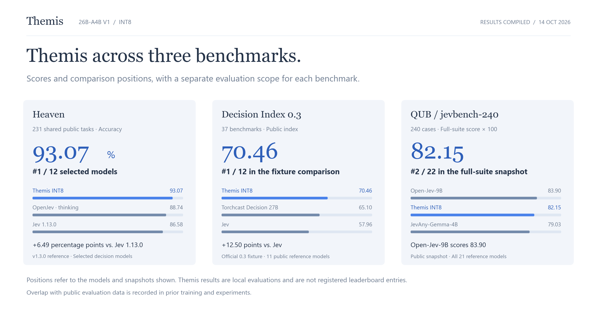
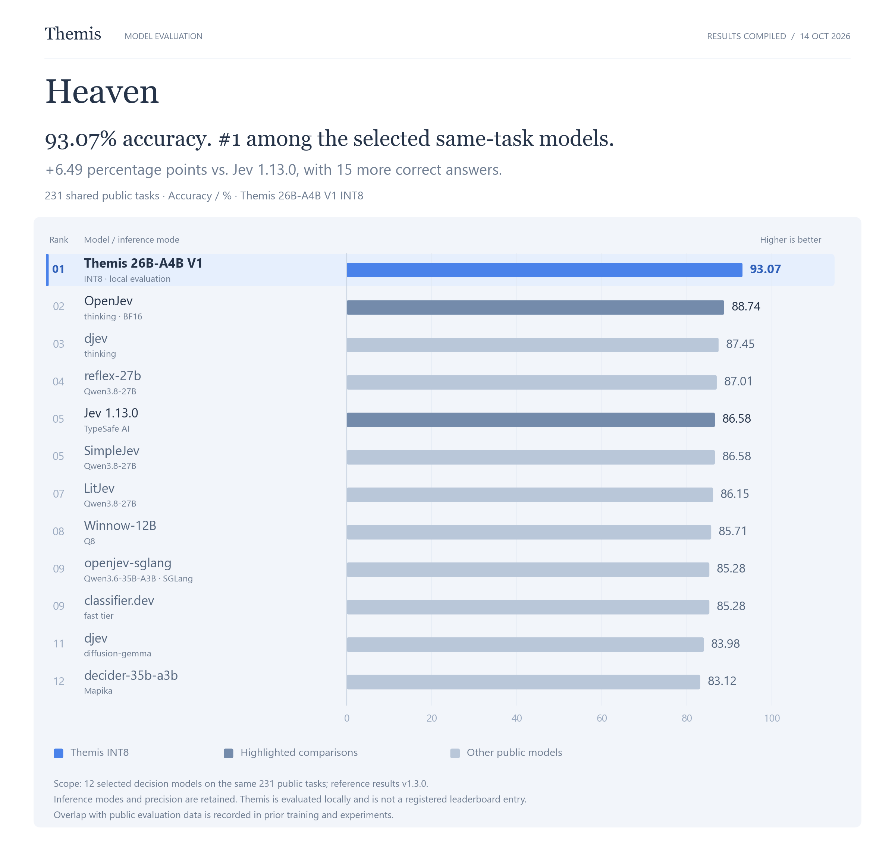
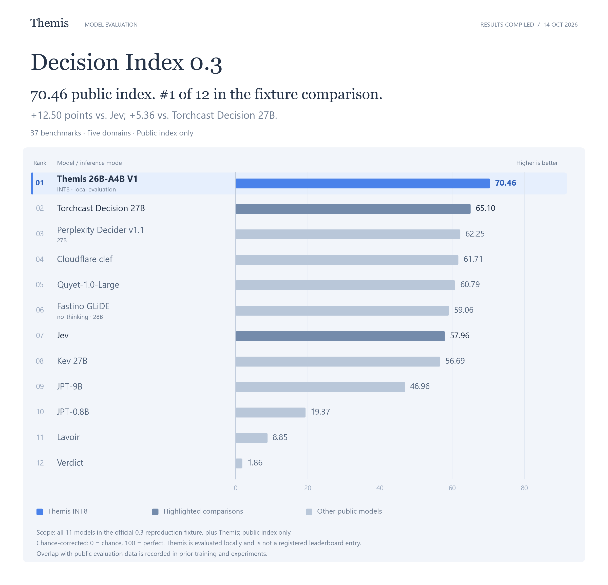
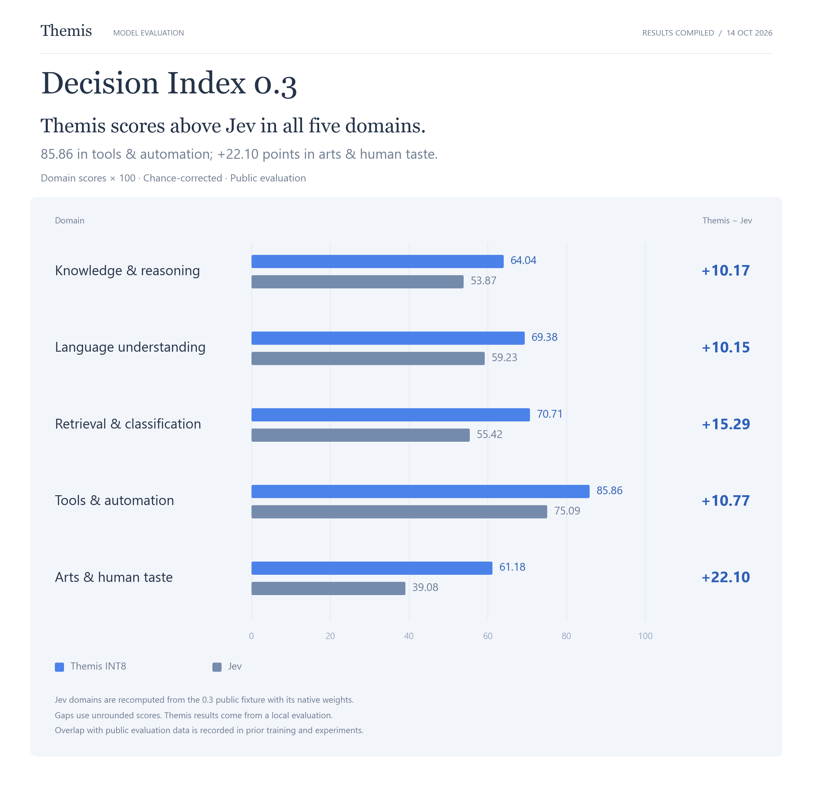
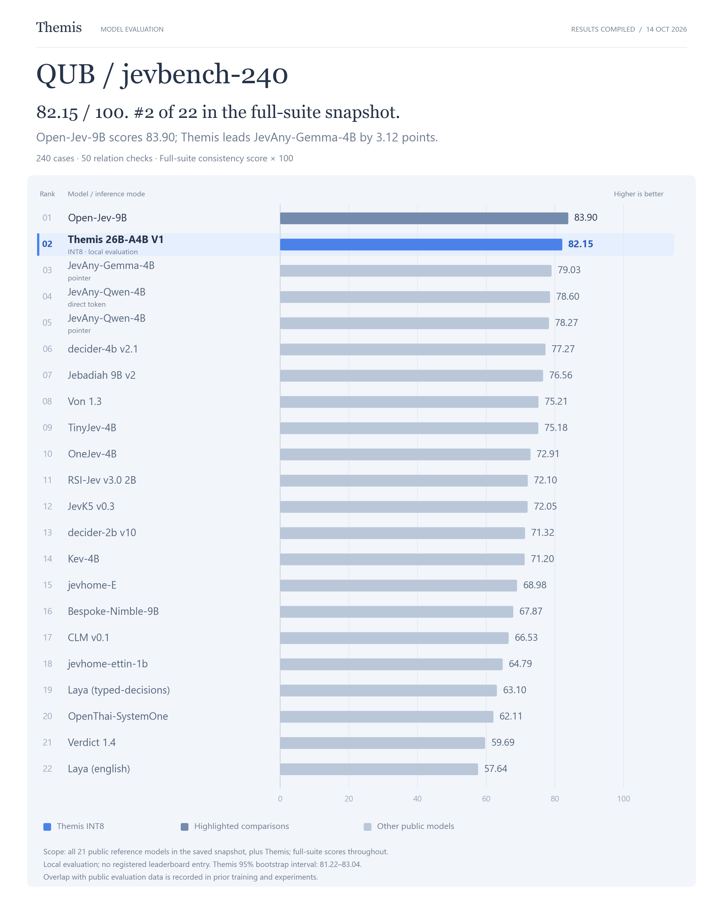

# 评测说明

[项目首页](../README.zh-CN.md) | [English](benchmarks.md)

记录日期：2026 年 10 月 14 日。以下结果由 Themis 项目根据已完成的评测和保存的公开基线快照整理。

排名仅适用于列出的基准版本与参考模型：Heaven 为所选 12 个模型，Decision Index 0.3 为公开复现文件中的 11 个模型加 Themis，QUB 为已保存的 21 个参考模型加 Themis。Themis 成绩来自本地评测，尚未登记为官方榜单条目。既往训练与实验记录中存在公开评测数据重合情况，请结合这一背景阅读结果。数值保留两位小数，排名与差值使用未舍入的原始分数计算。

## 2. 公开评测结果

| 评测 | Themis INT8 | 覆盖与口径 |
| --- | ---: | --- |
| **Heaven** | **93.07%** | 同一组 231 道公开题，答对 215 道，全部请求有效。 |
| **Decision Index 0.3** | **70.46** | 公开校正指数；原始指数 77.53；37 个题集、5 个领域，140,178 次有效请求。 |
| **QUB / jevbench-240** | **82.15 / 100** | 完整套件一致性分数；240 个案例、50 个关系检查、14,838 个 outcomes。 |

Heaven 衡量公开任务上的正确性，Decision Index 使用随机基线校正和领域加权，QUB 衡量概率与相关决策的一致性。以下按各自原生口径比较。

### 2.1 Heaven：同一组 231 道公开题

| 对照位置 | 模型与运行模式 | 答对题数 | 准确率 |
| ---: | --- | ---: | ---: |
| 1 | **Themis 26B-A4B V1 INT8** | 215 / 231 | **93.07%** |
| 2 | OpenJev（thinking · BF16） | 205 / 231 | 88.74% |
| 3 | djev（thinking） | 202 / 231 | 87.45% |
| 4 | reflex-27b（Qwen3.8-27B） | 201 / 231 | 87.01% |
| 5 | Jev 1.13.0（TypeSafe AI） | 200 / 231 | 86.58% |
| 5 | SimpleJev（Qwen3.8-27B） | 200 / 231 | 86.58% |
| 7 | LitJev（Qwen3.8-27B） | 199 / 231 | 86.15% |
| 8 | Winnow-12B（Q8） | 198 / 231 | 85.71% |
| 9 | openjev-sglang（Qwen3.6-35B-A3B · SGLang） | 197 / 231 | 85.28% |
| 9 | classifier.dev（fast tier） | 197 / 231 | 85.28% |
| 11 | djev（diffusion-gemma） | 194 / 231 | 83.98% |
| 12 | decider-35b-a3b（Mapika） | 192 / 231 | 83.12% |

在这组同题对照中，Themis INT8 比 Jev 1.13.0 多答对 **15 道题**，准确率高 **6.49 个百分点**；比 OpenJev thinking 高 **4.33 个百分点**。这里采用已保存的 231 题公开快照，保留各模型的运行模式。

Themis INT8 的 Heaven macro accuracy 为 **92.00%**，ECE 为 **0.02816**，Brier mean 为 **0.10814**，改写一致性为 **35 / 36（97.22%）**。

### 2.2 Decision Index 0.3：公开指数

| 对照位置 | 模型与运行模式 | 公开指数 | Themis INT8 − 对照 |
| ---: | --- | ---: | ---: |
| 1 | **Themis 26B-A4B V1 INT8** | **70.46** | — |
| 2 | Torchcast Decision 27B | 65.10 | +5.36 |
| 3 | Perplexity Decider v1.1（27B） | 62.25 | +8.21 |
| 4 | Cloudflare clef | 61.71 | +8.75 |
| 5 | Quyet-1.0-Large | 60.79 | +9.67 |
| 6 | Fastino GLiDE（no-thinking · 28B） | 59.06 | +11.40 |
| 7 | Jev | 57.96 | +12.50 |
| 8 | Kev 27B | 56.69 | +13.77 |
| 9 | JPT-9B | 46.96 | +23.50 |
| 10 | JPT-0.8B | 19.37 | +51.09 |
| 11 | Lavoir | 8.85 | +61.61 |
| 12 | Verdict | 1.86 | +68.60 |

Themis INT8 的公开指数比 Jev 高 **12.50 分**，比 Torchcast Decision 27B 高 **5.36 分**。本表使用 Decision Index 0.3 的公开部分；榜单 Full score 还包含维护者私有评测。

| 领域 | Themis INT8 | Jev | 差值 |
| --- | ---: | ---: | ---: |
| 知识与推理 | 64.04 | 53.87 | +10.17 |
| 语言理解 | 69.38 | 59.23 | +10.15 |
| 检索与分类 | 70.71 | 55.42 | +15.29 |
| 工具与自动化 | **85.86** | 75.09 | +10.77 |
| 艺术与人类偏好 | 61.18 | 39.08 | +22.10 |

五个领域覆盖率均为 100%。Jev 领域分数按对应公开分项及原生权重重算；Themis INT8 在这组对照的五个领域中均取得更高分数。

### 2.3 QUB：完整 jevbench-240

| 对照位置 | 模型与运行模式 | 完整套件分数 / 100 | Themis INT8 − 对照 |
| ---: | --- | ---: | ---: |
| 1 | Open-Jev-9B | 83.90 | -1.75 |
| 2 | **Themis 26B-A4B V1 INT8** | **82.15** | — |
| 3 | JevAny-Gemma-4B（pointer） | 79.03 | +3.12 |
| 4 | JevAny-Qwen-4B（direct token） | 78.60 | +3.55 |
| 5 | JevAny-Qwen-4B（pointer） | 78.27 | +3.88 |
| 6 | decider-4b v2.1 | 77.27 | +4.88 |
| 7 | Jebadiah 9B v2 | 76.56 | +5.59 |
| 8 | Von 1.3 | 75.21 | +6.94 |
| 9 | TinyJev-4B | 75.18 | +6.97 |
| 10 | OneJev-4B | 72.91 | +9.24 |
| 11 | RSI-Jev v3.0 2B | 72.10 | +10.05 |
| 12 | JevK5 v0.3 | 72.05 | +10.10 |
| 13 | decider-2b v10 | 71.32 | +10.84 |
| 14 | Kev-4B | 71.20 | +10.95 |
| 15 | jevhome-E | 68.98 | +13.17 |
| 16 | Bespoke-Nimble-9B | 67.87 | +14.28 |
| 17 | CLM v0.1 | 66.53 | +15.63 |
| 18 | jevhome-ettin-1b | 64.79 | +17.36 |
| 19 | Laya (typed-decisions) | 63.10 | +19.05 |
| 20 | OpenThai-SystemOne | 62.11 | +20.04 |
| 21 | Verdict 1.4 | 59.69 | +22.47 |
| 22 | Laya (english) | 57.64 | +24.52 |

对照采用已保存的完整套件成绩。Open-Jev-9B 比 Themis INT8 高 **1.75 分**；Themis INT8 高于表中的其余模型。本结果尚未作为官方榜单提交登记，TypeSafe Jev 1.13.0 在这一口径下缺少对应成绩。

| QUB 维度 | 含义 | Themis INT8 / 100 |
| --- | --- | ---: |
| REP | 表示变化下的一致性 | 87.61 |
| BAT | 批处理与问题隔离 | 97.33 |
| MEA | 概率测度一致性 | 58.97 |
| LOG | 逻辑约束一致性 | 94.63 |
| CHO | 选择一致性 | 72.22 |

QUB overall 的 95% bootstrap 区间为 **81.22–83.04**。完整运行完成 10,320 次真实调用，错误列表为空。

### 2.4 补充工作流评测

以下使用 WorkflowEvals 的 consensus 标签及各工作流原生指标。

| 工作流 / 指标 | Themis INT8 | Jev | 差值 |
| --- | ---: | ---: | ---: |
| 发票处理 / exact_actions | 58.67% | 61.78% | -3.11 个百分点 |
| 发票处理 / primary_action | 82.00% | 83.11% | -1.11 个百分点 |
| 客户服务 / exact_actions | 73.53% | 75.98% | -2.45 个百分点 |
| 安全事件 / exact_actions | 55.83% | 61.67% | -5.83 个百分点 |
| Agent 轨迹观测 / primary_action | 63.06% | 71.62% | -8.56 个百分点 |

四个工作流共 705 个案例完成执行，动作匹配质量按上表报告。Jev 对照来自相应公开记录；这些工作流中的 Themis INT8 指标低于该基线。
